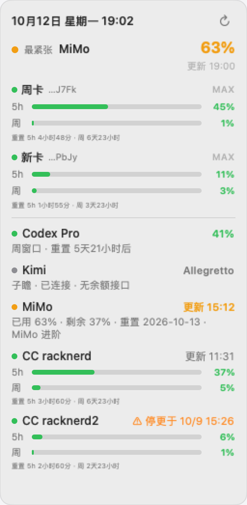

# QuotaDock

**macOS 多 AI 服务额度吸边仪表盘** —— 一张常驻悬浮卡片聚合你所有 AI 订阅的用量，打开 3 秒就能回答"哪个额度最紧张、数据新不新鲜、什么时候重置"；收起后变成贴屏细条，按紧张程度一目了然。零第三方依赖，全部行为可配置。



## 30 秒理解

- 面板顶部是**摘要卡**：当前最紧张的服务 + 大号百分比 + 最近重置倒计时 + 数据时间
- 下面是服务列表：智谱各 key 的 5h/周双进度条、Codex/Kimi/MiMo/Claude Code 用量行，全部按紧张度降序
- 点面板头部的**齿轮按钮**打开设置窗口：连接来源（路径/开关/服务器/手工 key）→ 验证（配置校验 + 单源立即抓取）→ 显示偏好（语言/阈值/剩余%/自动切换/勾选/退出），保存即写回 config.json 并热生效（保留你手写的未知字段）
- 面板头部：**⌄ 收起**（回吸边条）、**⚙ 设置**、**↻ 立即刷新**——不再有悬停弹层
- **默认收纳为吸边细条**：贴在你上次放的边和位置；**悬停 0.35s 自动展开**预览，鼠标离开 2.5 秒后自动收回去；**点击细条=固定展开**（不自动收），拖动面板或打开设置同样视为固定；"收起"按钮随时手动收。展开面板锚定在细条原位出现，收起回到最近的边——不乱跳
- 收纳态每项「彩色百分比 + 品牌 logo」，靠哪条屏边近就吸哪条，左右竖条、上下横条；同 logo 多实例自动加 ①② 角标；拖到别的边换向
- 临时故障（断网/限流/服务端 5xx）**保留最近成功值**并标注数据时间，绝不清空；只有服务端明确拒绝凭据才标记失效

## 它监控什么

| 服务 | 数据 | 方式 |
|---|---|---|
| 智谱 Coding Plan（多 key） | 5h 窗口% + 周额度% + 重置倒计时 | 官方监控接口，只读不耗额度；key 从 ZCode provider 配置自动发现，也可手工配置 |
| Codex（ChatGPT OAuth） | 周窗口% + credits | 官方用量接口，直连/代理交替重试 |
| Kimi | 5h 窗口% + 周% | 官方套餐接口（读本地 CLI 凭据） |
| MiMo | 已用% + 剩余% + 重置日 + 套餐名 | **纯被动零探针**：本地助手 `mimo-usage-sync` 走小米 SSO 只读拉取后写缓存，QuotaDock 只读缓存文件 |
| Claude Code（远程 VPS） | 5h% + 周% + 数据时间 | SSH 在**服务器上**跑 `claude -p /usage` 刷新后读缓存（凭据不出机、走 VPS 静态 IP）；`refreshUsage: false` 可退回纯被动 |

每个服务都可以在配置里单独开关。

## 隐私边界（读这一段再决定装不装）

QuotaDock 是**本地只读仪表盘**，没有账号系统、没有云端、没有遥测：

- **读取本地凭据文件**（只读，不出机器）：智谱 `~/.zcode/v2/`、Codex `~/.codex/auth.json`、Kimi `~/.kimi-code/`；key 只在内存中使用，不写日志、不进缓存文件
- **发起网络请求**的只有三个接口：智谱/ Codex / Kimi 的官方只读用量接口（凭证只发给对应官方域名）
- **不发请求**：MiMo（读本地缓存）、Claude Code（SSH 到你自己的服务器读文件；VPS 凭据不拷回本机）
- SSH 远端命令的 host/user/路径经过白名单校验，配置里的注入形态会被直接拒绝并列出修复提示
- 缓存文件（`~/.cache/quotadock/`）按构造只含用量数字，不含任何 token/key

## 安装（2 分钟）

需要 macOS 13+ 和 Xcode Command Line Tools（`xcode-select --install`）。

```bash
git clone <repo> && cd quotadock
./build.sh --install     # 编译 + 组装 app bundle + launchd 开机自启
```

装完即常驻右上角。手动运行：`QuotaDock.app/Contents/MacOS/QuotaDock`；查版本 `--version`。
卸载：

```bash
launchctl bootout gui/$(id -u)/local.quotadock
rm ~/Library/LaunchAgents/local.quotadock.plist
rm -rf <clone 目录>
```

## 配置

配置文件：`~/.config/quotadock/config.json`（不存在则全部用内置默认值；模板见 [`config.example.json`](config.example.json)，路径可用 `QUOTADOCK_CONFIG` 环境变量覆盖）。

改配置有两条路：**面板齿轮按钮打开设置窗口**（表单编辑，保存即生效），或直接手编 JSON。两条路互通——设置窗口保存时深度合并进现有文件，不碰你手写的未知字段。

**热加载**：改动后每 5 秒内自动生效（下一个刷新边界应用，不用重启）。非法字段自动回退默认值并在日志里给出修复提示；整个文件写坏时保留上一份有效配置。

| 字段 | 默认 | 说明 |
|---|---|---|
| `language` | `"zh"` | 界面语言，`"en"` 英文 |
| `timezone` | `"Asia/Shanghai"` | 倒计时/时间展示时区 |
| `refreshIntervalSeconds` | `180` | 刷新间隔（最小 30s） |
| `thresholds.yellow` / `red` | `60` / `85` | 用量配色分档线 |
| `zhipu.providerConfigPath` | `~/.zcode/v2/provider_config.json` | ZCode provider 配置自动发现（没有该文件就跳过） |
| `zhipu.credentialsPath` | `~/.zcode/v2/credentials.json` | ZCode 个人套餐加密凭据 |
| `zhipu.names` | `{}` | providerId → 显示名（如 `{"bigmodel-api-2": "周卡"}`） |
| `zhipu.keys` | `[]` | 手工配置 key：`[{"name": "...", "key": "..."}]`（可加 `"id"` 做稳定身份），与自动发现合并去重 |
| `codex.enabled` | `true` | 开关 |
| `codex.authPath` | `~/.codex/auth.json` | Codex CLI OAuth 凭据 |
| `codex.proxyHost` / `proxyPort` | `127.0.0.1` / `6152` | 代理重试路（Clash/Surge 常见端口）；`proxyPort: 0` 禁用 |
| `codex.retries` / `retryIntervalSeconds` | `4` / `15` | 直连/代理交替重试策略 |
| `codex` / `kimi` / `mimo` `.refreshIntervalSeconds` | `180` | 各服务独立刷新间隔（节流，未到期跳过并保留旧数据） |
| `kimi.enabled` / `credentialsPath` | `true` / `~/.kimi-code/...` | Kimi CLI 凭据（token 15 分钟过期，跑一次 `kimi` CLI 自动续期） |
| `mimo.enabled` / `cachePath` | `true` / `~/.cache/quotadock/mimo-usage.json` | 用量缓存（由 `./mimo-usage-sync` 写入；停更超 24h 标 ⚠） |
| `claudeCode.servers` | `[]` | 远程服务器列表：`{"host": "ssh别名", "name": "显示名", "sshPort": "", "user": "", "paths": ["/home/claude/.claude.json"]}`；多路径取快照最新；host/user/paths 白名单校验 |
| `claudeCode.sshConnectTimeout` | `10` | SSH 连接超时秒数（走跳板的两级握手约 5s） |
| `claudeCode.refreshUsage` | `true` | 先在服务器跑 `claude -p /usage` 刷新缓存再读；`false` 纯被动 |
| `claudeCode.refreshIntervalSeconds` | `600` | CC 服务器刷新间隔（快照只在有人用时才变，默认放宽到 10 分钟） |
| `claudeCode.sshMultiplexing` | `true` | SSH 连接复用（ControlMaster，跳板场景握手开销归零） |
| `autoPing.enabled` / `command` | `false` | 个人套餐 5h 窗口自动敲活命令（见 `glm-ping.swift`） |

凭据类文件（`auth.json`、`kimi-code.json`、SSH key）只在本机读取，QuotaDock 不向任何第三方发送。

## 故障排查

| 症状 | 原因 → 下一步 |
|---|---|
| 智谱某 key 显示"凭据失效" | key 被服务端关闭（401/403 或 code:1000）。续费/换 key 后点**立即刷新**——强制刷新会重探失效名单，成功自动恢复 |
| "暂时无法连接/接口限流/服务端错误" | 临时故障，保留了 HH:mm 的旧数据，稍后自动重试；持续出现查网络/代理 |
| Codex 一直转不出数据 | chatgpt.com 出口被 Cloudflare 拦：配 `codex.proxyPort` 走代理重试路；token 过期跑一次 `codex` CLI |
| Kimi 显示"token 过期" | token 仅 15 分钟有效且绑定设备会话：跑一次 `kimi` CLI 自动续期 |
| MiMo 一直"跑 mimo-usage-sync 同步额度" | 先手动跑 `./mimo-usage-sync`（本地只读 SSO 写缓存），再刷新 |
| CC 显示"SSH 失败" | 查 `ssh <host>` 能否直连（BatchMode，需密钥登录）、跳板握手时间是否超过 `sshConnectTimeout` |
| 改了配置没生效 | 热加载最多 5 秒 + 下一个刷新边界；日志（`/tmp/quotadock.out.log`）里有字段级修复提示 |
| 面板不见了 | 可能被拖到屏幕外。删掉位置键后重启恢复右上角默认位：`defaults delete local.quotadock.app panelFrame`（老版本域名可能是 `local.quotadock`） |

## Claude Code 数据源说明

Claude Code 把用量缓存在服务器 `~/.claude.json` 的 `cachedUsageUtilization`。**2.1.x 起普通对话不再写这个缓存**，所以 QuotaDock 默认先 SSH 在服务器上跑一次 `claude -p /usage`（`claudeCode.refreshUsage`，默认开；`servers[].user` 指定跑 claude 的系统账号），再读缓存。

安全约定：**VPS 凭据绝不拷回本机**；`claude` 调用只在服务器上发起，沿其静态 IP 代理出口。`refreshUsage: false` 则退回纯被动读缓存（可能长时间停更，超 24h 标 ⚠）。

## MiMo 数据源说明（零探针设计）

```bash
./mimo-usage-sync    # 本地只读 SSO，写 ~/.cache/quotadock/mimo-usage.json
```

助手从 MiMo Desktop 本机 cookie 取 `passToken`，走 `sid=mimopc` 换 `serviceToken` 后只读拉取用量/订阅，**不上报任何第三方**。QuotaDock 只读缓存文件——缓存不刷新数据就停在你最后一次跑助手的时刻，**建议装个定时器**（每 30 分钟）：

```bash
sed "s#__BIN__#$PWD/mimo-usage-sync#" scripts/mimo-sync.plist.template > ~/Library/LaunchAgents/local.quotadock.mimo-sync.plist
launchctl bootstrap gui/$(id -u) ~/Library/LaunchAgents/local.quotadock.mimo-sync.plist
```

需要 MiMo Desktop 处于登录状态（cookie 新鲜）；数据停更超 24h 面板会标 ⚠ 橙色提醒。

## 开发

```bash
swift build && swift test   # 单元测试（52 项）
./build.sh                  # release bundle（版本化 Info.plist）
# 离屏渲染 UI 效果图（不弹窗，内置 mock 数据）——改 UI 必跑
QUOTADOCK_RENDER=1 QUOTADOCK_LOGOS=$PWD/logos .build/debug/QuotaDock
QUOTADOCK_RENDER=1 QUOTADOCK_DARK=1 QUOTADOCK_LOGOS=$PWD/logos QUOTADOCK_OUT=/tmp/d.png .build/debug/QuotaDock
QUOTADOCK_RENDER=1 QUOTADOCK_STATE=empty QUOTADOCK_LOGOS=$PWD/logos QUOTADOCK_OUT=/tmp/e.png .build/debug/QuotaDock
QUOTADOCK_RENDER=1 QUOTADOCK_STRIP=1 QUOTADOCK_EDGE=top QUOTADOCK_LOGOS=$PWD/logos QUOTADOCK_OUT=/tmp/s.png .build/debug/QuotaDock
QUOTADOCK_RENDER=1 QUOTADOCK_SETTINGS=1 QUOTADOCK_LOGOS=$PWD/logos QUOTADOCK_OUT=/tmp/settings.png .build/debug/QuotaDock
```

架构、数据流、数据源契约和**新增数据源步骤**见 [docs/architecture.md](docs/architecture.md)；v2 设计规格见 `docs/superpowers/specs/`。运行日志：`/tmp/quotadock.out.log`。

### 贡献

- PR 前自查：`swift build` / `swift test` / `./build.sh` / UI 改动附离屏渲染截图（模板见 `.github/pull_request_template.md`）
- 保持零第三方运行时依赖；数据源不把凭据写进日志/缓存
- 新数据源欢迎，但需要官方只读接口 + 不要求上传凭据

### 性能设计

常驻开销：~40MB 内存、空闲 0% CPU（每 3 分钟一轮网络轮询）。在此之上：

- **各服务独立刷新节流**：Claude Code 快照只在服务器有人用时才变化，默认 600s 才查一次（SSH 进程与握手开销降 2/3）；未到期的轮次跳过并保留上一轮数据，UI 不闪空
- **SSH 连接复用**：ControlMaster/Persist（30 分钟），走跳板机的轮询从全握手降为毫秒级复用
- **重试不占线程**：Codex 的直连/代理交替重试用 async 调度，不停线程
- **重启零等待**：版本化缓存恢复上次会话的最近可信值（标注缓存时间）
- 手动点刷新按钮 = 全部服务强制立即刷新（无视节流 + 重探失效 key）

## License

[MIT](LICENSE)

---

# QuotaDock (English)

A macOS always-on AI quota dashboard that docks to your screen edge. One glance answers "which quota is tightest, is data fresh, when does it reset". Monitors Zhipu Coding Plan (multi-key), Codex, Kimi, MiMo (passive local cache) and remote Claude Code instances (usage snapshot read over SSH; credentials never leave your machines). Zero third-party dependencies, hot-reloading config, transient failures keep last-known-good values, bilingual UI (zh/en). Build with `./build.sh --install`.
